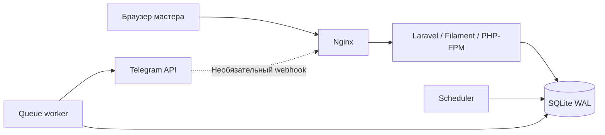

# Под капотом, без запаха ацетона

Pawlish вырос из Mani Webs: Laravel 12 + Filament 3, PHP 8.4, SQLite в режиме WAL и Vite. Код приложения находится в `src/`. Переход на новую версию не требует замены бизнес-стека или переписывания базы.

В Docker четыре сервиса: `app`, `web`, `worker`, `scheduler`. Очередь и планировщик работают как самостоятельные процессы, а не фоновые дети PHP-FPM. Все процессы Laravel используют один volume `sqlite_data`. Статические файлы публикуются в общем `public_assets`, доступном Nginx только для чтения. PHP-FPM не публикуется на хост.

## Данные и границы ответственности

- `Client`, `Service`, `Appointment`, `Expense`, `Setting`, `User` — Eloquent-модели. Клиенты архивируются через soft delete. Услуги с историей записей нельзя физически удалить: их можно деактивировать.
- `AppointmentTimePolicy` определяет рабочий день, календарные границы, шаг и длительность. Серверная модель валидирует сохранение; SQLite-триггеры защищают от пересечений даже при конкурирующих запросах.
- `FinancialReport` агрегирует оплаченные выполненные визиты и расходы. `FinancialReportExportController` формирует CSV/PDF для авторизованного пользователя.
- `SendMasterReminderJob` повторно читает запись из БД, проверяет её актуальность и отмечает отправку после подтверждения API.
- `expenses:create-recurring` создаёт записи ежемесячных расходов. Идентификатор шаблона и месяц защищены уникальным индексом.

## Время

База хранит локальное календарное время в согласованном часовом поясе приложения (наследие Mani Webs). Это не UTC-хранилище. Выберите пояс до первой записи; UI блокирует его изменение после появления записей, иначе старые значения получат другой смысл. Временные зоны с переходами DST могут иметь неоднозначные локальные моменты; автоматического преобразования истории нет. Для переноса между поясами нужна отдельная миграция.

Период создания и редактирования времени — примерно месяц назад и месяц вперёд, с календарным округлением без переполнения месяца. Начало округляется до 10 минут. Для фиксированной услуги длительность сохраняется точно; если она не помещается в рабочий день, запись отклоняется. Ночные смены через полночь не поддерживаются.

## Почему не PostgreSQL, Redis и Kubernetes?

У небольшого мастера один календарь и скромная нагрузка. WAL позволяет параллельное чтение, SQLite сериализует запись; `busy_timeout=5000` снижает вероятность временных конфликтов. База должна находиться на локальном диске одного хоста, не на NFS. Не запускайте несколько независимых экземпляров с разными БД. Миграции 0.2.0 рассчитаны именно на SQLite.

При росте нагрузки стоит отдельно проектировать многопользовательскую модель, аудит и миграцию на другой СУБД — это не входит в данный проект.
